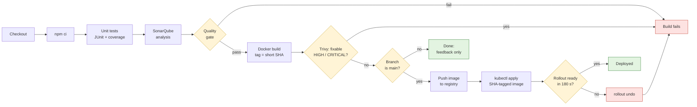

# jenkins-ci-cd-pipeline

[](https://github.com/IpshitaChaudhary/jenkins-ci-cd-pipeline/actions/workflows/ci.yml)


End-to-end CI/CD with Jenkins for a small Node.js service: unit tests, a SonarQube quality gate, a Docker image scanned with Trivy, and a Kubernetes deployment. Built up stage by stage; this README tracks what exists today.

## Status

| Stage | State |
|---|---|
| Checkout, install, unit tests (JUnit + coverage published) | Done |
| Docker image build (multi-stage, non-root, health check) | Done |
| SonarQube analysis + quality gate (blocks the image build) | Done |
| Trivy image scan (fails on fixable HIGH/CRITICAL, full report in Jenkins) | Done |
| Push to registry (main only, SHA tag) | Done |
| Deploy to Kubernetes with automatic rollback | Done |
| Architecture diagrams, badges, first release | Next |

## Pipeline

Every branch gets the checks; only `main` produces an image in the registry and a rollout. Any red step stops the build there.



## Layout

```
.
├── Jenkinsfile           # declarative pipeline
├── .github/workflows/    # ci.yml: tests, manifest validation, Dockerfile lint
├── .trivyignore          # accepted CVEs (reason, owner, expiry) - empty for now
├── k8s/                  # namespace (restricted PSS), Deployment, Service + PDB
├── ci/                   # local Jenkins + SonarQube (docker compose)
│   ├── docker-compose.yml
│   └── jenkins/          # Jenkins LTS + Docker CLI + plugins.txt
└── app/                  # the workload: inventory-api (Express)
    ├── src/              # app.js (routes), server.js (listener + graceful shutdown)
    ├── test/             # Jest + Supertest
    ├── Dockerfile
    ├── sonar-project.properties
    └── package.json
```

## The service

| Endpoint | Purpose |
|---|---|
| `GET /health` | Liveness/readiness check used by Docker and Kubernetes |
| `GET /api/items` | List items |
| `GET /api/items/:id` | One item, 404 if unknown |
| `POST /api/items` | Create an item; 400 on invalid input |

## Run it locally

```bash
cd app
npm ci
npm test            # unit tests + coverage (fails below 80% lines / 70% branches)
npm start           # http://localhost:3000/health
```

With Docker:

```bash
docker build -t inventory-api:local app
docker run --rm -p 3000:3000 inventory-api:local
```

## Run the pipeline locally (Jenkins + SonarQube)

```bash
# SonarQube's Elasticsearch needs this on a Linux host (Docker Desktop already has it)
sudo sysctl -w vm.max_map_count=262144

docker compose -f ci/docker-compose.yml up -d --build
docker compose -f ci/docker-compose.yml exec jenkins cat /var/jenkins_home/secrets/initialAdminPassword
```

One-time wiring:

1. **SonarQube** (http://localhost:9000): log in, change the admin password, then *My Account → Security* → generate a token.
2. **SonarQube webhook**: *Administration → Configuration → Webhooks* → `http://jenkins:8080/sonarqube-webhook/`. The quality gate stage waits for this callback.
3. **Jenkins** (http://localhost:8080): finish the setup wizard, add the token as a *Secret text* credential (e.g. `sonarqube-token`).
4. **Jenkins → Manage Jenkins → System → SonarQube servers**: name `sonarqube`, URL `http://sonarqube:9000`, token credential from step 3.
5. Create a *Pipeline* job pointing at this repo (*Pipeline script from SCM*, script path `Jenkinsfile`).

## Deploying to Kubernetes

Two more Jenkins credentials, then run the job with the `REGISTRY` parameter set:

| Credential ID | Type | What |
|---|---|---|
| `registry-creds` | Username with password | Registry login (for Docker Hub use an access token, not the password) |
| `kubeconfig` | Secret file | kubeconfig for a deployer service account limited to the `inventory` namespace |

```bash
# after a deploy
kubectl -n inventory get deploy,pods,svc,pdb
kubectl -n inventory rollout history deployment/inventory-api   # each revision = build + commit
kubectl -n inventory port-forward svc/inventory-api 8081:80     # http://localhost:8081/health
```

## Pipeline design notes

- **Image tags are the short commit SHA**, never `latest`, so every running image maps to exactly one commit.
- **Tests run in a throwaway `node:20-alpine` container**, so the Jenkins agent needs only Docker, not a Node toolchain.
- **Quality gate before the image build.** Code that fails the SonarQube gate never becomes an image, so nothing downstream (scan, registry, cluster) ever sees it.
- **Image scan gates the push, not just reports.** Trivy runs twice against the same cached DB: a non-blocking pass that publishes *every* finding as JUnit (so each build shows its vulnerability list next to the unit tests), then the gate, which fails only on HIGH/CRITICAL that already have a fixed version. Unfixed CVEs stay visible without blocking, because there's nothing to upgrade to yet.
- **Accepting a CVE is a reviewed change.** `.trivyignore` entries need a reason, an owner and an expiry date, and go through a PR like code.
- **Pinned scanner version.** `TRIVY_VERSION` is fixed so two builds of the same commit can't get different results from a silent scanner upgrade; bump it deliberately.
- **Only main ships.** Every branch gets tests, SonarQube and Trivy feedback; only `main` pushes an image and deploys.
- **Git never names an image tag.** `k8s/deployment.yaml` holds `IMAGE_PLACEHOLDER`; the pipeline substitutes the exact SHA-tagged image it just scanned and pushed, so the cluster can only run something that passed every gate.
- **A bad rollout undoes itself.** `kubectl rollout status` waits on the readiness probes; if new pods aren't ready within 180 s, the pipeline runs `rollout undo` and fails. With `maxUnavailable: 0`, the old pods keep serving the whole time.
- **Locked-down pods.** Non-root, read-only root filesystem, all capabilities dropped, no service-account token, RuntimeDefault seccomp - and the namespace enforces the `restricted` Pod Security Standard, so a less strict pod is rejected outright.
- **No secrets in the repo.** The SonarQube URL and token come from `withSonarQubeEnv`; `sonar-project.properties` holds only project settings. The registry login and kubeconfig come from Jenkins credentials bindings, the registry token goes in through `--password-stdin`, and the agent logs out after the push.
- **Two layers of checks.** GitHub Actions runs the fast checks on every push and PR (unit tests, `kubeconform -strict` on the manifests, hadolint on the Dockerfile); Jenkins runs the full delivery pipeline with the quality gate, image scan, registry push and deploy.
